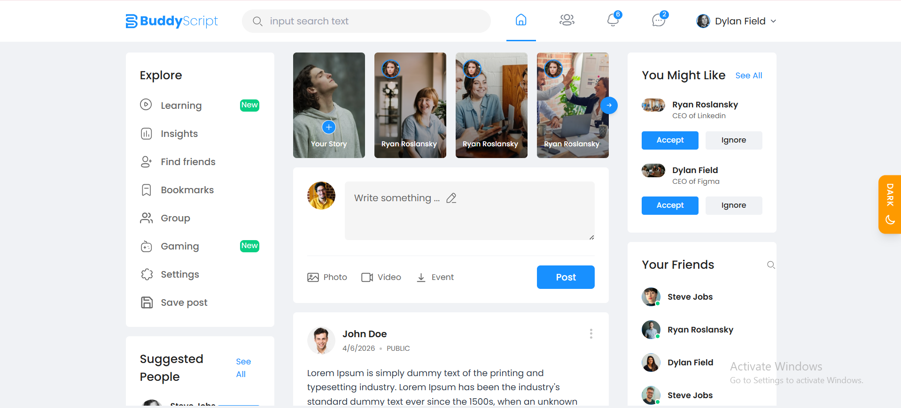

# Social Feed Application - Frontend

A modern, responsive Social Feed Frontend built with **React.js** and **Tailwind CSS**. This application delivers a seamless user experience with features like infinite scrolling, real-time feedback, and persistent authentication.

📸 Preview:


---

## 🚀 Key Features

- **Dynamic Infinite Feed**: Real-time content loading using `IntersectionObserver` and cursor-based pagination with duplicate prevention.
- **Real-Time Synchronization**: WebSocket integration with RTK Query's `onCacheEntryAdded` for instant UI updates (likes, comments, avatars).
- **Optimistic UI Updates**: Instant feedback for likes and comments to ensure zero perceived latency.
- **Robust State Management**: Powered by **Redux Toolkit** and **RTK Query** for efficient caching and synchronization.
- **Persistence & Auth**: Secure JWT handling with automatic token refresh via `async-mutex` to prevent concurrent request storms.
- **Media Support**: Support for image and video post display, including native video controls and Cloudinary integration.
- **Rich Interactions**: 
  - Real-time like/unlike feedback.
  - Nested comment systems with threaded replies.
  - Content-based search filtering.
- **Responsive Design**: Mobile-first architecture with a dedicated mobile bottom navigation and dark/light theme support.
- **User Feedback**: Standardized toast notifications via `react-hot-toast` for all CRUD operations.

---

## 🛠 Technology Stack

- **Framework**: [React.js](https://reactjs.org/) (Vite)
- **State Management**: [Redux Toolkit](https://redux-toolkit.js.org/)
- **Data Fetching**: [RTK Query](https://redux-toolkit.js.org/rtk-query/overview)
- **Real-time**: [Socket.io-client](https://socket.io/docs/v4/client-api/)
- **Styling**: [Tailwind CSS](https://tailwindcss.com/)
- **Routing**: [React Router v6](https://reactrouter.com/)
- **Icons/Media**: Lucide-react & SVG-based assets
- **Validation**: [React Hook Form](https://react-hook-form.com/) & Zod

---

## 📦 Getting Started

### **Prerequisites**
- Node.js (v20 or higher)
- npm or yarn

### **Installation**

1. **Clone the repo and navigate to the frontend directory:**
   ```bash
   cd buddy-script-frontend
   ```

2. **Install dependencies:**
   ```bash
   npm install
   ```

3. **Configure Environment Variables:**
   Create a `.env` file in the root directory:
   ```env
   VITE_APP_BASE_URL="http://localhost:3000"
   ```

4. **Start the Development Server:**
   ```bash
   npm run dev
   ```

---

## 🏗 Project Structure

- `src/redux`: Contains RTK Query API slices and Redux logic (including `onCacheEntryAdded` listeners).
- `src/components`: Reusable UI components (Feed, Auth, Common).
- `src/hooks`: Custom hooks like `useRealtime` for room management.
- `src/pages`: Main application views (Login, Register, Feed).
- `src/context`: React Context providers (Theme, Auth).
- `src/types`: Centralized TypeScript interfaces for API responses and entities.

---

## 📖 Key Modules

### **Real-Time Synchronization**
Implemented via `useRealtime` hook and RTK Query cache listeners. When a post is viewed, the client joins a specific WebSocket room (`post:{id}`) to receive targeted updates.

### **Authentication**
Managed via `authSlice.ts`. Stores tokens in `localStorage` and provides a base query interceptor for automatic token refresh logic.

### **Feed & Posts**
Located in `components/Feed`. Implements a robust infinite scroll trigger using `IntersectionObserver` with a container-aware root for smooth loading.

---

## 🧪 Testing & Deployment

- **Build for Production**: `npm run build`
- **Preview Build**: `npm run preview`
- **Linting**: `npm run lint`

---

## 🛡 Performance & Optimization
- **Atomic Cache Updates**: RTK Query `updateCachedData` is used to update specific post items without re-fetching the entire list.
- **Duplicate Prevention**: Feed merge logic filters out duplicate posts that might appear during rapid real-time updates.
- **Infinite Scroll**: Uses a proactive `rootMargin` and container-based root to start loading the next page before the user hits the bottom.
- **Bundle Optimization**: Tree-shaking and asset compression via Vite.

---

## 🤝 Contributing
Please read the root `CONTRIBUTING.md` for details on our code of conduct and the process for submitting pull requests.

---

## 📄 License
This project is licensed under the MIT License.
